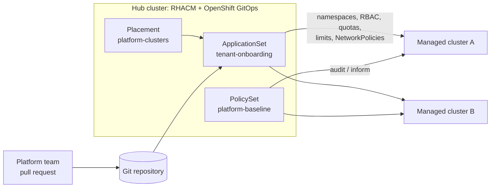

# OpenShift Multicluster Platform Lab

[](https://github.com/kevinaugusto0/openshift-multicluster-platform-lab/actions/workflows/validate.yaml)

Tenant onboarding as code and baseline governance across a fleet of OpenShift clusters, using **Red Hat Advanced Cluster Management (RHACM)** and **OpenShift GitOps (Argo CD)**.

Onboarding a new project becomes a pull request: a folder under `onboarding/tenants/` is turned into a namespace with RBAC, quotas, limits and network policies on every cluster in the fleet, while RHACM audits that every cluster stays compliant.

> In my day job I used this approach to cut project onboarding on OpenShift/Kubernetes from **15 days to 30 minutes**. This repository is a clean-room lab version of the pattern: no employer code, configuration or data.

## Architecture



1. Clusters join the `platform` **ManagedClusterSet**.
2. A **Placement** selects the OpenShift clusters of that set, and a **GitOpsCluster** registers them in the hub's Argo CD.
3. An **ApplicationSet** combines the placement decisions with the tenant folders in Git (matrix generator), creating one Argo CD Application per tenant per cluster.
4. A **PolicySet** applies baseline governance to the same clusters and reports drift.

## What is inside

| Path | What it does |
|---|---|
| `hub/00-clusterset.yaml` | ManagedClusterSet `platform` and the bindings for the GitOps and policy namespaces |
| `hub/10-gitops-registration.yaml` | Placement, GitOpsCluster and the `acm-placement` ConfigMap used by the ApplicationSet |
| `hub/20-applicationset-tenants.yaml` | ApplicationSet that deploys every tenant folder to every placed cluster |
| `governance/platform-baseline.yaml` | Policies, PolicySet, Placement and PlacementBinding for baseline governance |
| `onboarding/base/` | Day-one baseline every tenant gets (Kustomize) |
| `onboarding/tenants/<team>/` | One folder per tenant: namespace, admin group, quota overrides |
| `.github/workflows/validate.yaml` | CI: yamllint, `kustomize build` and kubeconform on every push and PR |

## Tenant baseline

Every tenant namespace gets:

- `ResourceQuota` and `LimitRange` with sane defaults (overridable per tenant)
- `default-deny-ingress` NetworkPolicy, plus explicit allows for same-namespace traffic, the OpenShift router and cluster monitoring
- `RoleBinding` granting the tenant's group the `admin` ClusterRole in its own namespace
- Labels for ownership and cost allocation (`platform.lab/tenant`, `platform.lab/cost-center`)

## Governance

| Policy | Checks | Mode |
|---|---|---|
| `policy-tenant-baseline` | Every `team-*` namespace has the default-deny NetworkPolicy, the ResourceQuota and the LimitRange | inform |
| `policy-kubeadmin-removed` | The `kubeadmin` bootstrap secret has been removed | inform |
| `policy-etcd-encryption` | etcd encryption is enabled on the API server | inform |

Policies run in `inform` mode on purpose: Git is the source of truth and Argo CD remediates, while RHACM gives an auditable, fleet-wide compliance view.

## Getting started

Prerequisites:

- An OpenShift hub cluster with **RHACM 2.10+** and the **OpenShift GitOps** operator installed
- One or more managed OpenShift clusters imported into RHACM
- `oc` logged in to the hub with cluster-admin

```bash
# 1. Add your managed clusters to the platform clusterset
oc label managedcluster <cluster-name> cluster.open-cluster-management.io/clusterset=platform --overwrite

# 2. Clusterset, bindings, GitOps registration and the tenant ApplicationSet
oc apply -f hub/

# 3. Baseline governance
oc apply -f governance/

# 4. Check
oc get placementdecision -n openshift-gitops
oc get applications -n openshift-gitops
oc get policy -n platform-policies
```

If you fork this repository, update `repoURL` in `hub/20-applicationset-tenants.yaml`.

## Onboarding a new tenant

```bash
cp -r onboarding/tenants/team-fraud onboarding/tenants/team-checkout
# edit namespace.yaml (name, cost center) and kustomization.yaml (namespace, admin group)
kustomize build onboarding/tenants/team-checkout   # preview
git checkout -b onboard-team-checkout && git add . && git commit -m "Onboard team-checkout" && git push
```

Merge the pull request and the ApplicationSet creates `<cluster>-team-checkout` on every placed cluster.

## Notes

- This is a lab: the ApplicationSet uses the `default` Argo CD project. In production, scope tenants with a dedicated `AppProject`.
- `policy-etcd-encryption` checks for `aescbc`; switch to `aesgcm` if that is your standard.
- Manifests target OpenShift (router and monitoring NetworkPolicy labels, `APIServer` config), but the onboarding pattern works on any Kubernetes cluster managed by Open Cluster Management.

## Author

**Kevin Silva**, Platform Engineer & SRE: Kubernetes, OpenShift, multicluster.
Red Hat Certified Engineer in OpenShift · Red Hat Certified Specialist in OpenShift Advanced Cluster Management.
[LinkedIn](https://www.linkedin.com/in/kevinsilva-sre)

## License

[MIT](LICENSE)
